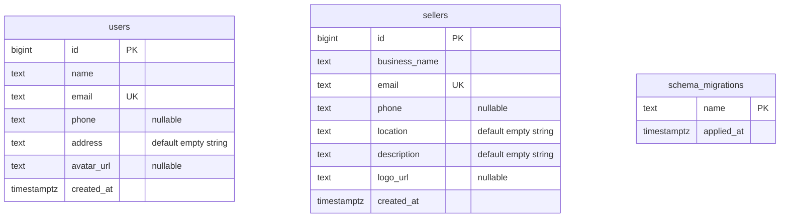

# Mid-review database ERD

The current application uses two independent tables. Profiles are fields on these tables, so there is no separate profile table or relationship to maintain.

The [SQL migration](../db/migrations/001_mid_review.sql) creates `users` and `sellers`. The migration runner creates the administrative `schema_migrations` table to remember applied files. There are deliberately no foreign keys in this checkpoint because the application tables are independent.

Primary keys are generated identities. Unique email constraints automatically create indexes; primary keys are indexed as well. Emails must be lowercase, names must be nonblank, and names/emails/creation times cannot be null. Optional phones and image URLs may be null. Zod provides additional API validation for emails, phone formatting, URL schemes, and text length limits.

Future authentication work must decide whether to link sellers to user accounts or introduce a shared account table. That relationship is not implemented here.
