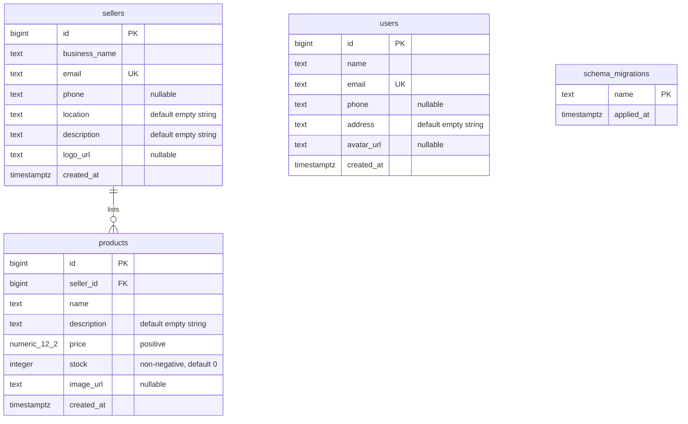

# Mid-review database ERD

The current application has three application tables. Sellers own products; users remain separate. User/seller profiles are fields on their respective tables, so there is no separate profile table or relationship to maintain.

The [SQL migration](../db/migrations/001_mid_review.sql) creates `users` and `sellers`. The migration runner creates the administrative `schema_migrations` table to remember applied files. The [product migration](../db/migrations/002_products.sql) adds `products` with a `seller_id` foreign key to `sellers.id` using `ON DELETE RESTRICT`. A seller can have zero or many products, and each product has one seller. Products must be deleted before their seller. Users have no relationship to sellers yet. `numeric_12_2` denotes PostgreSQL `NUMERIC(12,2)`.

An index on `products.seller_id` supports seller filtering. Product checks require a nonblank name, positive price, and non-negative stock. Primary keys are generated identities. Unique email constraints automatically create indexes; primary keys are indexed as well. Emails must be lowercase, names must be nonblank, and names/emails/creation times cannot be null. Optional phones and image URLs may be null. Zod provides additional API validation for emails, phone formatting, URL schemes, and text length limits.

Future authentication work must decide whether to link sellers to user accounts or introduce a shared account table. That relationship is not implemented here.
