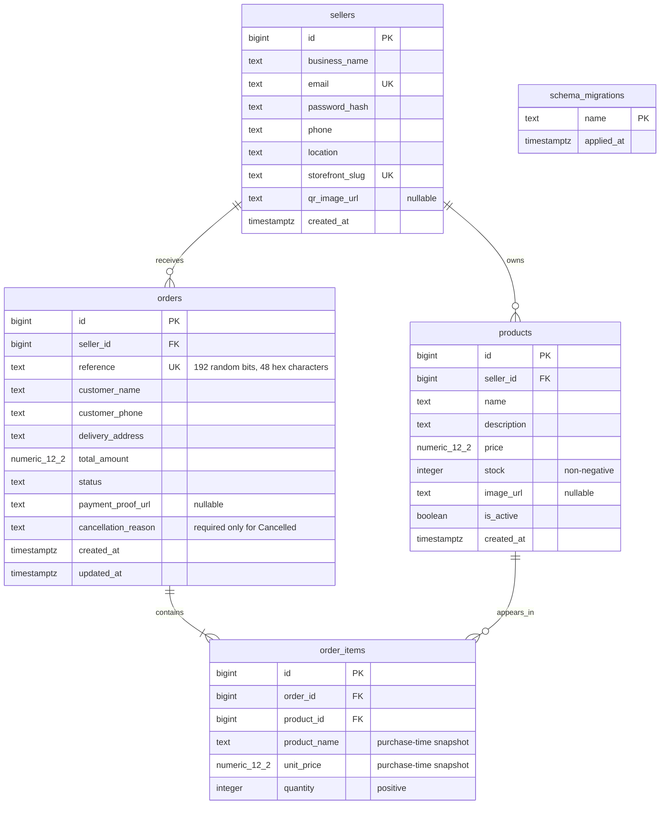

# Database ERD

This matches `db/migrations/001_initial.sql`. All foreign keys use `ON DELETE RESTRICT`.

`numeric_12_2` denotes PostgreSQL `NUMERIC(12,2)`. Money must be positive. `order_items` also has a composite unique constraint on `(order_id, product_id)`; duplicate checkout lines are merged before insertion. The migration runner creates the separate administrative `schema_migrations` table.

Order creation requires at least one item at the API level; the foreign key alone does not require a child row. Product-to-storefront consistency and status transition history are enforced by the service transaction. The database additionally constrains allowed status values, cancellation reason consistency, monetary values, quantities, stock, normalized emails, and reference/slug formats.

Indexes support seller product listings, active storefront products, seller order listings with/without status filters, and product references from order items. Primary keys and unique constraints create their own indexes; the `(order_id, product_id)` unique index also supports fetching items by order.
