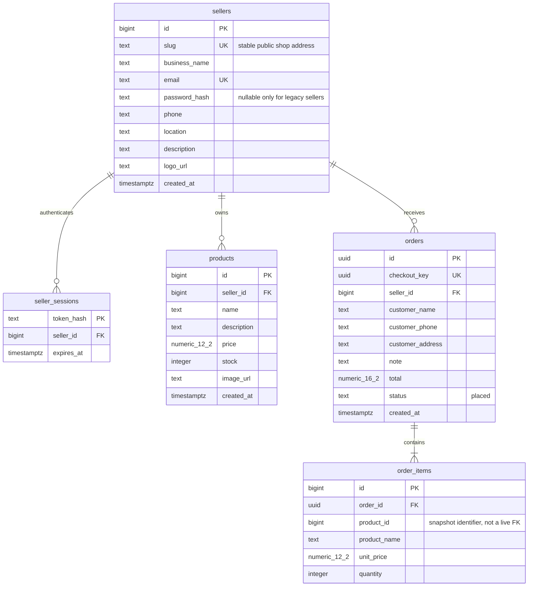

# Sprint 1–2 database ERD

Open the [editable draw.io diagram](tshongkhang-erd.drawio) in diagrams.net. The active flow uses seller accounts, sessions, products, orders and order items. Seller profile fields live on `sellers`; guest contact details live on each `orders` row.

`order_items.product_id`, name and price are snapshots. Deliberately avoiding a live product foreign key lets a seller delete a catalog product while preserving the original order and checkout retry comparison. `order_id` remains a foreign key to the saved order. Orders and products restrict deletion of their seller; sessions cascade when a seller is deleted.

Migration `003_sprint_two.sql` extends the previous schema without deleting existing data. `users` remains as a legacy table with `id`, `name`, `email`, `phone`, `address`, `avatar_url` and `created_at`; it has no active routes and is not used by guest checkout. `schema_migrations` tracks applied files. Both are included in the draw.io diagram for completeness.

Product prices and order line prices use `NUMERIC(12,2)`; order totals use `NUMERIC(16,2)`. APIs serialize these as decimal strings. Unique email and checkout-key constraints and the primary keys are indexed. Additional indexes support products/orders/sessions by seller, session expiration and items by order.

The application enforces cart limits, seller ownership and customer input validation. Checkout inserts orders and items and updates stock in one transaction with product row locks. The browser does not supply a trusted price or total.

Migration `004_shop_slugs.sql` adds the unique, non-null seller `slug`, validates its format and reserves application route names. Existing shop names are converted to addresses in ID order, with collision suffixes. New registrations allocate addresses transactionally. Changing a business name does not change its slug.
